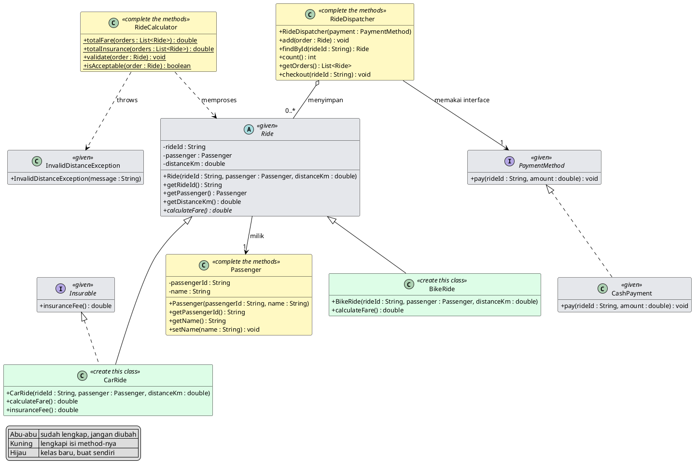
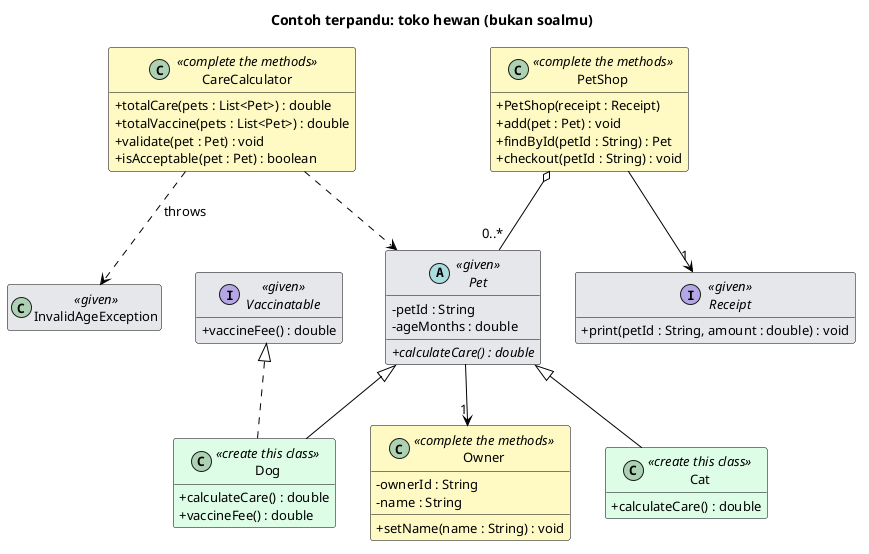

# OOP Practice Quiz 2: Ride Hailing

🇮🇩 Versi Bahasa Indonesia: [README.id.md](README.id.md)

Working time: **120 minutes**. Maximum score: **100 points**, graded automatically every time you push.

## Case Study

You are building the core of a **Ride Hailing** application. Every ride has a kind (**motorbike ride** and **car ride**), and each kind calculates its fare by its own rule. Only one kind offers trip insurance. A ride is valid only when the distance is more than 0 and at most 50 km. All rides are kept in the **ride dispatcher**, then paid through the **payment method**.

This quiz covers **Meetings 9 to 11**: abstract classes and interfaces, polymorphism and `instanceof`, exceptions, `ArrayList` and `Map`, and the SOLID principles.

## How This Quiz Works

The quiz has **five stages of increasing difficulty**. The order follows the lectures, so start at stage 1.

| Stage | Topic | Points |
|---|---|---:|
| 1 | Warm-up: class and encapsulation | 15 |
| 2 | Abstract class and interface (Meeting 9) | 20 |
| 3 | Polymorphism and exceptions (Meeting 10) | 20 |
| 4 | Collections (Meeting 11) | 15 |
| 5 | SOLID (Meeting 11) | 30 |

- **Stages 1 to 3 are worth 55 points.** If you finish all three, you pass comfortably.
- **Each stage stands on its own.** The tests for stages 3 to 5 use classes made by the tests, not your own classes. If you are stuck on one stage, move on to the next: you can still earn its points.
- **All tests are visible.** Open the `src/test` folder to read what is checked. You may read the tests, but you must not change them.
- **A failing test gives a hint.** The failure message names the rule that was broken.

## Class Diagram

The class diagram is the **main specification**. Every class name, field, constructor, and method you need is there.



The colors tell you what to do:

| Color | Meaning |
|---|---|
| Gray (given) | Already complete, do not change it. |
| Yellow (complete the methods) | The class exists. Fill in the method bodies. |
| Green (create this class) | The class does not exist yet. Create it yourself. |

## Business Rules

| Topic | Rule |
|---|---|
| motorbike ride (`BikeRide`) | fare = distance x Rp 2,500 per km |
| car ride (`CarRide`) | fare = distance x Rp 4,000 per km. Offers trip insurance (`Insurable`) for a fixed fee of Rp 3,000. |
| motorbike ride | Does not offer trip insurance. |
| Invalid distance | Valid only when the distance is more than 0 and at most 50 km. Otherwise, throw an exception with the message `Invalid distance: ` followed by the value, for example `Invalid distance: 55.0`. |
| Checkout | The ride dispatcher asks the payment method to record the code and the fare. |

Use the type `double` for distance, fare, and fees.

## Worked Example: Pet Shop

Before you start, look at one example that is already explained: a **pet shop** (a different problem from yours). Its diagram has the same shape as yours.



The example goes through the stages one by one. Notice the pattern, then apply it to the Ride Hailing.

| Stage | In the pet shop | In the Ride Hailing |
|---|---|---|
| 1 | `Owner`: keep the owner's name, reject a blank name. | `Passenger`: keep the passenger's name, reject a blank name. |
| 2 | `Cat` and `Dog` extend `Pet`. Only `Dog` implements `Vaccinatable`. | `BikeRide` and `CarRide` extend `Ride`. Only `CarRide` implements `Insurable`. |
| 3 | `CareCalculator` adds up the care cost of all pets in one loop, checks vaccines with `instanceof Vaccinatable`, and rejects a pet with an invalid age by throwing `InvalidAgeException`. | `RideCalculator` does the same for rides. |
| 4 | `PetShop` keeps pets in a `List` and finds them by code with a `Map`. | `RideDispatcher` does the same for rides. |
| 5 | `PetShop` receives a `Receipt` from outside through its constructor. It does not create the printer itself, and it does not print itself. A new kind of pet works at once without changing `PetShop`. | `RideDispatcher` receives a `PaymentMethod` from outside. A new kind of ride works at once without changing `RideDispatcher`. |

## Stage 1: Warm-up (15 points)

**Goal:** complete `Passenger` so that it stores data and keeps the name valid.

**What you do:**

1. Declare fields for the code and the name. Every field is `private`.
2. Fill in the constructor and both getters.
3. Fill in `setName`: a name that is `null`, empty, or only spaces is ignored, and the old name stays.

<details>
<summary>Hint</summary>

Fields are written at the top of the class, each starting with `private`. In the constructor, the parameter values are moved into the fields with the word `this`. For a name made only of spaces, remember that `String` has a method that removes spaces at the ends and a method that checks whether the text is empty.
</details>

**How to test:** `mvn test -Dtest="PassengerConstructorGetterTest,PassengerEncapsulationTest"`

## Stage 2: Abstract Class and Interface (20 points)

**Goal:** create two subclasses of `Ride`, and give an extra ability to only one of them.

**What you do:**

1. Create the class **`BikeRide`** that `extends Ride`. The constructor takes three parameters as in the diagram and passes them to `super`. Fill in `calculateFare()`: distance x Rp 2,500 per km.
2. Create the class **`CarRide`** that `extends Ride` and `implements Insurable`. Fill in `calculateFare()`: distance x Rp 4,000 per km. Fill in `insuranceFee()`: Rp 3,000.
3. `BikeRide` must **not** implement `Insurable`.

<details>
<summary>Hint</summary>

Create the new class in the same folder as the other classes. A subclass constructor takes three parameters like the abstract class constructor, then calls `super` on its first line. The `@Override` mark helps the compiler confirm that you really fill in the abstract method. An interface is used with the word `implements`, and a class that uses it must fill in every method of that interface.
</details>

**How to test:** `mvn test -Dtest="SubclassStructureTest,BikeRidePriceTest,CarRidePriceTest,AbilityInterfaceTest,AbstractAndInterfaceRulesTest"`

## Stage 3: Polymorphism and Exceptions (20 points)

**Goal:** complete `RideCalculator` so that it processes many rides through the `Ride` type, and rejects invalid data with an exception.

**What you do:**

1. `totalFare`: add up the fare of all rides in one loop. An empty list gives 0.
2. `totalInsurance`: add up the trip insurance fee of the rides that have that ability. Check with `instanceof Insurable`, not with a subclass name.
3. `validate`: throw `InvalidDistanceException` when the distance is invalid, with the message `Invalid distance: ` followed by the value.
4. `isAcceptable`: call `validate` inside `try`/`catch`. Return `true` when valid and `false` when the exception is thrown.

<details>
<summary>Hint</summary>

One loop is enough. Inside it, call the same method on each object and let each object answer by its own rule: that is polymorphism. For the extra ability, ask whether the object is a `Insurable` (not whether it is a `CarRide`), so that other kinds with the same ability are counted too. The `validate` method uses `throw` to throw a new exception. The `isAcceptable` method catches it with `catch` and returns a boolean, so the exception does not leave that method.
</details>

**How to test:** `mvn test -Dtest="TotalPriceTest,TotalAbilityTest,ValidateTest,IsAcceptableTest"`

## Stage 4: Collections (15 points)

**Goal:** complete `RideDispatcher` so that it stores rides and finds them quickly.

**What you do:**

1. Fill in the constructor: store the payment method it is given, and prepare empty collections.
2. `add`: store the ride in a `List` **and** in a `Map` (the key is the ride code).
3. `findById`: look it up through the `Map`. If the code does not exist, return `null`.
4. `count` and `getOrders`: the number and the list in the order they were added.

Do not use arrays.

<details>
<summary>Hint</summary>

Two collections work side by side: the `List` remembers the order, the `Map` finds by key. The `add` method fills both. A `Map` returns `null` for a key that does not exist, so `findById` needs no loop at all. Make every field `private`.
</details>

**How to test:** `mvn test -Dtest="DeskAddCountTest,DeskFindByIdTest,DeskFindMissingTest,DeskOrderTest,DeskCollectionsTest"`

## Stage 5: SOLID (30 points)

**Goal:** apply the SOLID principles in `RideDispatcher` through one method, `checkout`.

**What you do:**

1. Keep the payment method from the constructor in a field of the **interface** type `PaymentMethod`.
2. `checkout`: find the ride by its code, then ask that payment method to record the code and the fare. If the code does not exist, do nothing.
3. `RideDispatcher` must **not** record anything itself, and must **not** create a `CashPayment` inside itself.
4. Do not check subclass names. A new kind of ride must work at once without changing `RideDispatcher` or `RideCalculator`.

The tests of this stage create a new kind of ride **inside the tests** to prove that your code does not need to change.

| Principle | How the tests check it |
|---|---|
| Dependency Inversion (DIP) | `RideDispatcher` holds a `PaymentMethod` (the interface), not the concrete class. A fake printer from the tests must receive the call. |
| Single Responsibility (SRP) | `RideDispatcher` does not use `System.out`. Recording is the payment method's job. |
| Open/Closed (OCP) | A new kind made by the tests is accepted and counted without any change to your code. |
| Liskov Substitution (LSP) | Every subclass of `Ride`, including one whose fare is 0, is treated the same way. |

<details>
<summary>Hint</summary>

The constructor takes an object of an interface type and keeps it in a field of the interface type. In `checkout`, just find the ride and hand its code and fare to the printer. You do not need to know whether the printer prints to the screen, to a file, or elsewhere: that is the printer's business. For the fare, call `calculateFare()` on the object, whatever its kind.
</details>

**How to test:** `mvn test -Dtest="DeskInterfaceTest,CheckoutUsesPrinterTest,DeskPrintsNothingTest,NewSubclassNoChangeTest,SubstitutionTest,NoConcretePrinterTest"`

## Try It Manually

`Main.java` is a free playground for trying your program (not graded). After stages 2 to 5 are done, you can write an experiment there. As a reference, the correct results for 5 km are:

- motorbike ride: fare `12500.0`.
- car ride: fare `20000.0` and trip insurance fee `3000.0`.
- The sum of both fares: `32500.0`.
- Checkout of the ride numbered `L1` (motorbike ride) produces the line: `Payment L1: Rp 12500.0`.

Run it from NetBeans (**Run Project**), VS Code (**Run** above `main`), or the terminal:

```bash
mvn -q compile exec:java
```

## Getting Started

This repository is a **template**:

1. Click the green **Use this template** button, then **Create a new repository**. Set the visibility to **Private**, and name it, for example, `oop-quiz2-ride-<your-name>`.
2. Clone **your** new repository:
   ```bash
   git clone git@github.com:<your-username>/oop-quiz2-ride-<your-name>.git
   ```
3. Open the project in your editor, work stage by stage, then commit and push.
4. Every push runs the autograder. Open the **Actions** tab of your repository to see your score. If GitHub asks you to enable workflows, click **I understand my workflows, enable them**.

## Opening the Project

This is a standard Maven project, with no extra configuration.

**NetBeans**
1. **File, Open Project...**
2. Select the `oop-quiz2-ride-...` folder (NetBeans recognizes it as a Maven project), then **Open Project**.
3. Right-click the project, then **Test** to run all tests. A single test runs from the `Test Packages` node.

**Visual Studio Code**
1. Install the **Extension Pack for Java** (Microsoft).
2. **File, Open Folder...** and select the cloned folder.
3. Run the tests from the **Testing** sidebar (flask icon), or from the terminal: `mvn test`.

## Reading the Test Results

Run `mvn test` in the terminal, or look at the **Actions** tab. Every failing test writes one sentence that names the **rule that was broken**. Fix one test group at a time, then run that group again. If you see the error `Not implemented yet`, that method is still empty.

## Grading

Total **100 points**, split across 22 test groups. A group earns its points when every test inside it passes. Run everything with `mvn test`, or one group with `mvn test -Dtest=TestClassName`.

| # | Test group | Stage | Points |
|---|---|---|---:|
| 1 | Passenger Constructor and Getter Test | 1 | 5 |
| 2 | Passenger Encapsulation Test | 1 | 10 |
| 3 | Subclass Structure Test | 2 | 4 |
| 4 | BikeRide Price Test | 2 | 4 |
| 5 | CarRide Price Test | 2 | 4 |
| 6 | Insurable Interface Test | 2 | 4 |
| 7 | Abstract Class and Interface Rules Test | 2 | 4 |
| 8 | RideCalculator Total Price (Polymorphism) Test | 3 | 5 |
| 9 | RideCalculator Insurable Total (instanceof) Test | 3 | 5 |
| 10 | RideCalculator Validate (Exception) Test | 3 | 5 |
| 11 | RideCalculator isAcceptable (try/catch) Test | 3 | 5 |
| 12 | RideDispatcher Add and Count Test | 4 | 3 |
| 13 | RideDispatcher Find By Id Test | 4 | 3 |
| 14 | RideDispatcher Find Missing Returns Null Test | 4 | 3 |
| 15 | RideDispatcher Keeps Insertion Order Test | 4 | 3 |
| 16 | RideDispatcher Uses List and Map Test | 4 | 3 |
| 17 | RideDispatcher Depends on PaymentMethod Interface Test (DIP) | 5 | 5 |
| 18 | Checkout Uses Injected PaymentMethod Test (DIP) | 5 | 7 |
| 19 | RideDispatcher Prints Nothing Itself Test (SRP) | 5 | 4 |
| 20 | New Subclass Needs No Change Test (OCP) | 5 | 8 |
| 21 | Any Subclass Substitutes Test (LSP) | 5 | 3 |
| 22 | No Concrete PaymentMethod Inside RideDispatcher Test (DIP) | 5 | 3 |
| | **Total** | | **100** |

## Rules

- **Do not modify** any file under `src/test/**` or `.github/**`.
- Follow the class diagram exactly: class names, fields, methods, and signatures are used by the autograder.
- All fields must be `private`.
- In `RideDispatcher`, use `List` and `Map`. Do not use arrays.
- Gray classes are already complete and must not be changed.
- Work on your own. Similar repositories will be checked.
